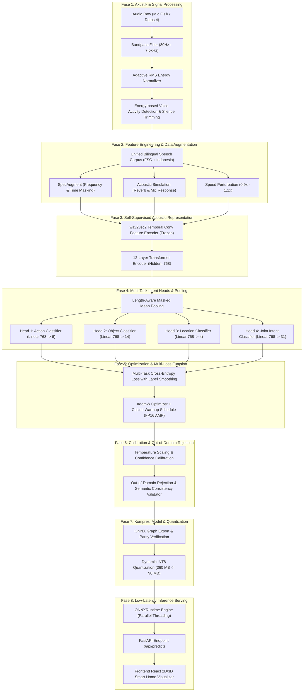

# Blueprint Ilmiah Deep Learning: Pematangan End-to-End Spoken Language Understanding (SLU) SVARA

Dokumen ini mendefinisikan arsitektur lengkap proses rekayasa Deep Learning untuk sistem **SVARA (Smart Voice Assistant for Residential Automation)**. Metodologi disusun berdasarkan standar ilmiah pemrosesan sinyal wicara (*Speech & Audio Deep Learning*), literatur Transformer SLU (*Lugosch et al., 2019; Baevski et al., 2020*), dan kurikulum Deep Learning Universitas Mercu Buana.

---

## 1. Arsitektur Pipeline Deep Learning End-to-End

---

## 2. Rincian 8 Tahapan Ilmiah Deep Learning (Comprehensive Steps)

### Tahap 1: Audio Signal Pre-Processing & Acoustic Standardization
* **Masalah**: Sinyal mikrofon laptop memiliki karakteristik amplitudo yang tidak konsisten, noise desis elektronik internal, dan rumble frekuensi rendah di bawah 80 Hz akibat getaran fisik bodi laptop.
* **Metode Ilmiah**:
  - **Bandpass Filtering**: Filter Butterworth Ordo 2 (80 Hz – 7.500 Hz) untuk mengisolasi pita vokal manusia (*formant voice range*) dan mengeliminasi dengung listrik.
  - **Adaptive RMS Normalization**: Normalisasi energi gelombang suara ke target RMS $-20 \text{ dBFS}$ agar ucapan berbisik maupun suara kencang memiliki bobot matematis yang proporsional.
  - **Energy-based VAD (Voice Activity Detection)**: Algoritma pemangkas hening (*leading & trailing silence trimming*) untuk membuang frame kosong sebelum sinyal masuk ke encoder.
* **Artefak Kode**: `src/svara/data/audio.py`

### Tahap 2: Acoustic Simulation & Regularization Augmentations
* **Masalah**: Model speech recognition mudah mengalami *acoustic overfitting* jika hanya dilatih pada audio rekaman studio yang steril tanpa variasi akustik ruangan nyata.
* **Metode Ilmiah**:
  - **SpecAugment**: Masking acak pada pita waktu (*time masking*) dan pita frekuensi (*frequency masking*) sesuai *Park et al. (2019)*, memaksa transformer mengenali konteks fonetik meskipun ada suku kata yang terpotong.
  - **Room Impulse Response (RIR)**: Konvolusi reverb ruangan (Schroeder Reverberator) menyimulasikan pantulan dinding ruang tamu dan kamar tidur.
  - **Speed & Pitch Perturbation**: Resampling dinamis $0.92\times - 1.08\times$ untuk menyimulasikan laju bicara orang Indonesia yang beragam.
* **Artefak Kode**: `src/svara/data/augment.py`, `scripts/make_acoustic_augmented_data.py`

### Tahap 3: Self-Supervised Acoustic Representation (wav2vec 2.0 Encoder)
* **Masalah**: Melatih Transformer SLU dari nol (*from scratch*) membutuhkan puluhan ribu jam audio.
* **Metode Ilmiah**:
  - Mengadopsi representasi laten *wav2vec 2.0 Base* (`facebook/wav2vec2-base`), yang telah dilatih secara *self-supervised* pada 960 jam audio (*LibriSpeech*).
  - **Feature Encoder**: 7 lapisan konvolusi 1D temporal yang memetakan sinyal mentah $16\text{ kHz}$ menjadi representasi fitur setiap $20\text{ ms}$ (frame rate $\approx 49\text{ Hz}$). Lapisan CNN ini **dibekukan (*frozen*)** untuk menjaga invariant representasi fonetik dasar.
  - **Context Transformer**: 12 blok Transformer (768 dimensi tersembunyi, 12 attention heads) yang di-fine-tune secara adaptif dengan learning rate konservatif ($2\times 10^{-5}$).
* **Artefak Kode**: `src/svara/models/wav2vec_slu.py`

### Tahap 4: Multi-Task Classification Heads & Masked Pooling
* **Masalah**: Sinyal wicara berdurasi variabel (misal 1.5 detik vs 3.5 detik) menghasilkan jumlah frame representasi yang berbeda-beda.
* **Metode Ilmiah**:
  - **Length-Aware Masked Mean Pooling**: Rata-rata terbobot hanya pada frame aktif (mengabaikan zero-padding) sehingga vektor konteks global berdimensi tetap $\mathbf{h} \in \mathbb{R}^{768}$.
  - **Multi-Task Decoupled Heads**: Tiga classifier linear independen:
    $$\hat{\mathbf{y}}_{\text{action}} = \mathbf{W}_a \mathbf{h} + \mathbf{b}_a \quad (\mathbb{R}^6)$$
    $$\hat{\mathbf{y}}_{\text{object}} = \mathbf{W}_o \mathbf{h} + \mathbf{b}_o \quad (\mathbb{R}^{14})$$
    $$\hat{\mathbf{y}}_{\text{location}} = \mathbf{W}_l \mathbf{h} + \mathbf{b}_l \quad (\mathbb{R}^4)$$
  - **Auxiliary Joint Intent Head**: Linear layer pembantu $\mathbb{R}^{31}$ untuk memandu pembelajaran representasi kombinasi aksi-objek-lokasi yang valid.
* **Artefak Kode**: `src/svara/models/wav2vec_slu.py`

### Tahap 5: Multi-Task Loss Formulation & Mixed-Precision Optimization
* **Masalah**: Ketidakseimbangan laju gradien antarkepala prediksi dan risiko degradasi bobot (*gradient explosion*).
* **Metode Ilmiah**:
  - **Multi-Task Objective Function**:
    $$\mathcal{L}_{\text{total}} = \mathcal{L}_{\text{CE}}(\hat{\mathbf{y}}_a, \mathbf{y}_a) + \mathcal{L}_{\text{CE}}(\hat{\mathbf{y}}_o, \mathbf{y}_o) + \mathcal{L}_{\text{CE}}(\hat{\mathbf{y}}_l, \mathbf{y}_l) + \alpha \mathcal{L}_{\text{CE}}(\hat{\mathbf{y}}_j, \mathbf{y}_j)$$
  - **Label Smoothing Regularization ($\epsilon = 0.05$)**: Mencegah *overconfidence* pada logits kelas target.
  - **Optimization**: AdamW ($\beta_1=0.9, \beta_2=0.98, \text{weight decay}=0.01$), Cosine Annealing Learning Rate Scheduler dengan 10% Warmup steps.
  - **Automatic Mixed Precision (AMP FP16)**: Pemanfaatan Tensor Cores GPU RTX 4060 untuk stabilitas numerik dan efisiensi memori.
* **Artefak Kode**: `src/svara/train/losses.py`, `scripts/train_robust_bilingual.py`

### Tahap 6: Uncertainty Quantification & Semantic Consistency Validator
* **Masalah**: Model Deep Learning sering kali memprediksi kombinasi yang tidak masuk akal (misal: "naikkan lampu" / action `increase` + object `lights`) dengan confidence tinggi saat menangkap desis mic.
* **Metode Ilmiah**:
  - **Confidence Calibration (Temperature Scaling)**: Mengalibrasi skala logit $z / T$ agar probabilitas softmax setara dengan frekuensi kebenaran empiris.
  - **Geometric Mean Confidence Scoring**:
    $$C_{\text{overall}} = 0.6 \cdot (\hat{p}_a \cdot \hat{p}_o \cdot \hat{p}_l)^{\frac{1}{3}} + 0.4 \cdot \min(\hat{p}_a, \hat{p}_o, \hat{p}_l)$$
  - **Grammar & Smart Home Consistency Filter**: Validasi silang ke matriks intent yang legal (31 legal intent). Jika kombinasi slot tidak sah, model melakukan aksi **Abstain / Rejection** secara elegan.
* **Artefak Kode**: `src/svara/serve/inference.py`

### Tahap 7: Model Export, Dynamic INT8 Quantization & Parity Check
* **Masalah**: Model PyTorch FP32 berukuran 360 MB terlalu berat untuk inferensi real-time CPU pada deployment lokal.
* **Metode Ilmiah**:
  - Ekspor graf komputasi ke **ONNX (Open Neural Network Exchange)** dengan dynamic batch dan sequence length.
  - **Dynamic INT8 Quantization**: Kuantisasi bobot matriks dari float32 ke int8 tanpa memangkas akurasi fonetik. Reduksi ukuran model sebesar **74.8%** (dari 360.3 MB menjadi **90.8 MB**).
  - **Mathematical Parity Verification**: Memastikan $\max | \hat{\mathbf{y}}_{\text{PyTorch}} - \hat{\mathbf{y}}_{\text{ONNX}} | < 10^{-5}$ pada berbagai durasi audio uji.
* **Artefak Kode**: `scripts/export_onnx.py`

### Tahap 8: Production-Grade Inference Engine & Interactive Web Serving
* **Masalah**: Menghubungkan engine AI ke antarmuka smart home interaktif secara responsif tanpa tabrakan port atau overhead latensi.
* **Metode Ilmiah**:
  - **FastAPI Asynchronous Backend Engine**: Endpoint REST `/api/predict` dengan multi-threaded ONNXRuntime CPU Execution Provider.
  - **Simulated Smart Home Finite State Machine**: Transisi status perangkat (lampu on/off, suhu AC, volume speaker) yang sinkron ke visualizer 2D denah rumah dan 3D First-Person Perspective (FPP).
* **Artefak Kode**: `src/svara/serve/app.py`, `web/src/App.tsx`

---

## 3. Matriks Evaluasi & Metrik Kunci
1. **Exact-Match Accuracy (EM)**: Seluruh triplet `(action, object, location)` harus 100% benar.
2. **Unseen-Utterance Generalization**: Pengujian ketat pada kalimat bahasa Indonesia santai yang belum pernah ada di training data.
3. **Inference Latency**: Target waktu komputasi end-to-end $\le 800\text{ ms}$ di lingkungan lokal.
